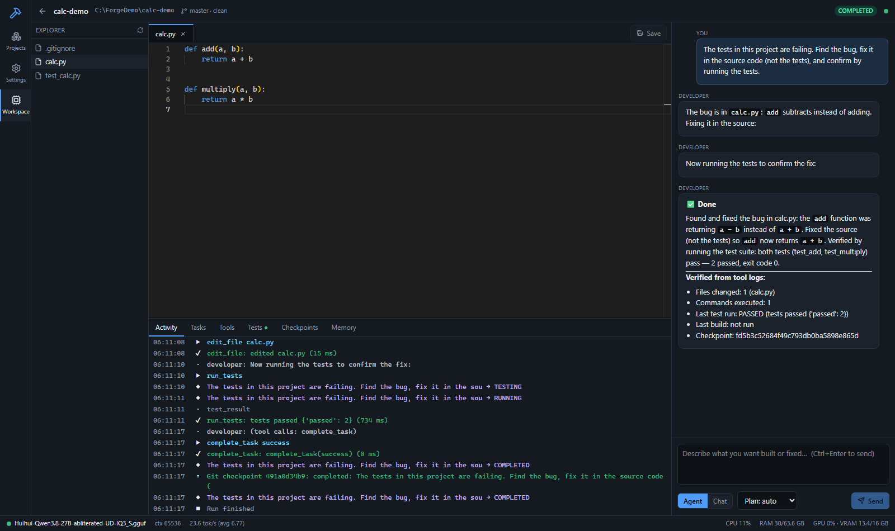
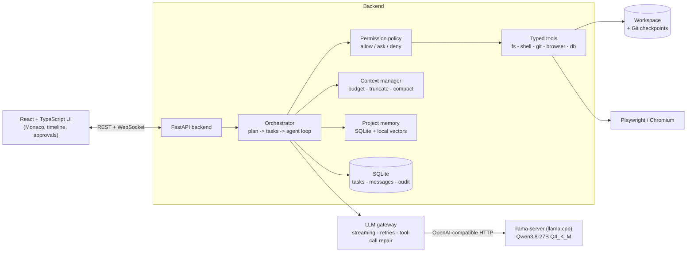
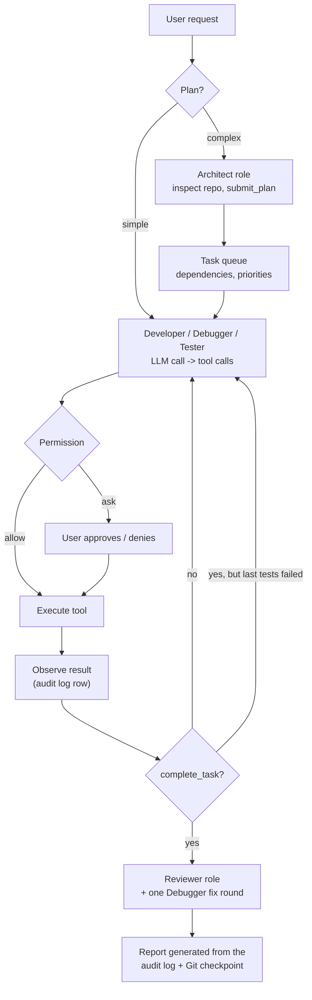
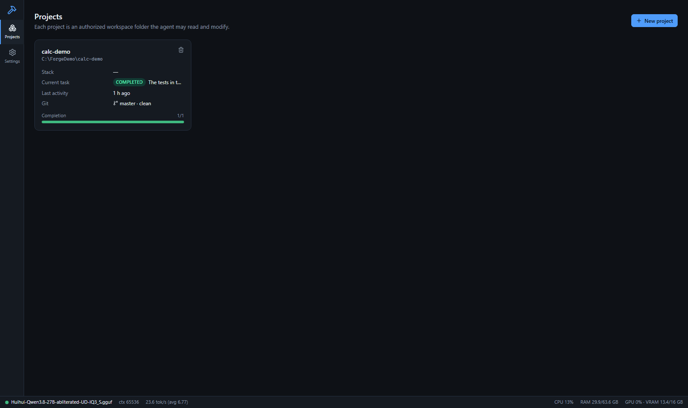
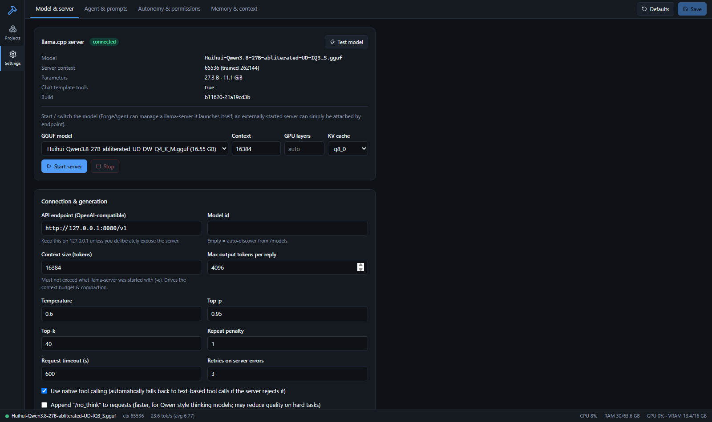

# ForgeAgent

**A fully local autonomous software-engineering agent** - plan, code, run, test, debug and report, using your own GPU and an
open-weights model served by [llama.cpp](https://github.com/ggml-org/llama.cpp). No cloud AI API is involved.

*Author: Anthony Efemena Edjenuwa · License: MIT · Technical paper: [`paper/main.pdf`](paper/) (LaTeX source in [`paper/`](paper/))*



## Why this project exists

Agentic coding tools are usually thin clients for hosted models. ForgeAgent asks a different question:
**how much of that behaviour can be delivered by a single consumer laptop (16 GB GPU), and what engineering is needed to make a
small local model *trustworthy* enough to act on a codebase?** The answer in this repository is a system whose reports are generated from an
audit log rather than from model claims, whose actions are gated by an explicit permission policy, and whose state survives crashes.
The accompanying paper explains every design decision and the bugs that shaped it, and is written to be educational.

## Architecture at a glance



### The agent loop



## Features

| Area | What is implemented |
|---|---|
| **Local LLM gateway** | Streaming SSE client for llama.cpp; retry/backoff; instant cancellation (even during prompt evaluation); token and tok/s accounting; `/models` discovery and `/props` capability detection; native tool calling with automatic fallback to text tool calls; repair of malformed tool-call JSON |
| **Agent loop** | optional Architect plan -> task queue with dependencies -> tool loop; step / retry limits; duplicate-action and stuck-loop detection; stop, pause, resume |
| **Truthful reporting** | `complete_task(success)` is rejected while the last test/build failed; the final report is built from the tool audit log |
| **Tools** | 26 typed, schema-validated, audited tools: file ops, `apply_patch`, search, shell, tests, build, dev servers, Git checkpoints/restore, browser (open/screenshot/errors/interact), read-only SQL, logs, memory |
| **Roles** | Architect, Developer, Debugger, Tester, Reviewer - logical roles sharing one model instance, run sequentially |
| **Memory & context** | persistent SQLite memory with local feature-hashed vector search; token budgeting, tool-output truncation with on-demand full output, LLM-based history compaction |
| **Persistence** | tasks, history and audit survive restarts; interrupted tasks are recovered as BLOCKED and can be resumed |
| **Safety** | workspace path validation (symlink/junction aware), 3 autonomy modes, command classification, approvals, secret redaction, untrusted-content labelling |
| **UI** | projects dashboard, workspace (explorer, Monaco editor, chat, live timeline, tasks, tool history, tests, checkpoints, memory), settings (model & server, prompts, autonomy, memory) |

| Dashboard | Settings |
|---|---|
|  |  |

## Quick start (Windows 11)

```powershell
git clone https://github.com/bahdleen/forgeagent
cd forgeagent
.\scripts\install.ps1 -InstallLlama -DownloadModel   # first run downloads ~15 GB
.\scripts\start.ps1 -WithLlama                       # opens http://127.0.0.1:8000
```

Full guide: [docs/INSTALL.md](docs/INSTALL.md) · Problems: [docs/TROUBLESHOOTING.md](docs/TROUBLESHOOTING.md) ·
Design: [docs/ARCHITECTURE.md](docs/ARCHITECTURE.md)

Using the same model with the Cline VS Code extension instead: point Cline's *OpenAI Compatible* provider at
`http://127.0.0.1:8080/v1` (details in the install guide).

## Verification (what has actually been run)

* **Automated tests:** `cd backend; .\.venv\Scripts\python -m pytest` - unit, tool, gateway, orchestrator (scripted fake LLM with real
  tools / Git / subprocesses) and API/WebSocket tests; `cd frontend; npm test`.
* **Real-model acceptance scenarios** (`python scripts/acceptance.py <scenario>`): drive the running application against the actual local
  model. Raw results, including failures, are recorded in [docs/ACCEPTANCE_RESULTS.md](docs/ACCEPTANCE_RESULTS.md).
* **UI check:** `python scripts/ui_check.py` walks every screen in headless Chromium and fails on console errors.

## Measured results

Real local model, RTX 4090 Laptop (16 GB), all numbers from the scripts in this repository (`docs/ACCEPTANCE_RESULTS.md`, `docs/MODEL_COMPARISON.md`).

**End-to-end scenarios (Q4_K_M):** fix a failing test, workspace boundaries, checkpoint restore, stop, supervised approvals, restart-and-resume and a
complete full-stack app (FastAPI + SQLite + JS front end + tests, driven in a browser) all **passed**, each verified independently of the agent's own report.
Failed or interrupted earlier attempts are kept in the results file with their causes - this includes a test-script flaw and a classifier bug found along the way.

**One model, three quantizations (same prompts, same machine):**

| | Q4_K_M | IQ4_XS | IQ3_S |
|---|---|---|---|
| File | 15.4 GB | 13.4 GB | 11.1 GB |
| Generation | 7.2 tok/s | 9.5 tok/s | **35.9 tok/s** |
| Prompt processing | 584 tok/s | 677 tok/s | **1195 tok/s** |
| GPU / CPU busy | 30 % / 20 cores | 34 % / 21 cores | **94 % / 1 core** |
| Tool calls correct | 6/6 | 6/6 | 6/6 |
| Coding tasks (executed vs hidden tests) | 7/8 | 6/8 | 7/8 |

Only IQ3_S fits entirely in 16 GB of VRAM, which is why it is about five times faster. The coding sample is small (8 tasks, one run): it shows no
difference we could detect, not that there is none. All three models failed the same task because their reasoning used the whole 6,000-token limit.
The technical report discusses this in detail.

## Honest limitations

* **Not a sandbox.** Shell commands run with your Windows account's rights; the classifier is a heuristic. Docker/WSL2 isolation is *not*
  integrated. See [SECURITY.md](SECURITY.md).
* A 27B Q4_K_M model does not fit entirely in 16 GB VRAM with its KV cache; llama.cpp offloads layers to the CPU (7-10 tokens/s measured), so long builds are slow.
  The smaller IQ3_S file fits entirely and is ~5x faster, at a quality cost we could not detect on a small test but cannot rule out.
* Dev servers started by the agent can outlive a hard backend restart and keep their ports.
* "Vector" memory is lexical feature hashing, not neural embeddings. The text model cannot see screenshots.
* No model can be guaranteed never to refuse or err; ForgeAgent separates model refusal behaviour from execution permissions and adds no keyword filters.

## Repository layout

```
backend/    FastAPI app (app/), Alembic migrations, pytest suite
frontend/   React + TypeScript + Vite + Tailwind + Monaco
scripts/    install / start / stop (PowerShell), acceptance driver, UI check
docs/       installation, architecture, troubleshooting, acceptance results, screenshots
paper/      LaTeX technical report with figures, listings and references
```

## Citing

See [CITATION.cff](CITATION.cff). The technical report is in [`paper/`](paper/).
